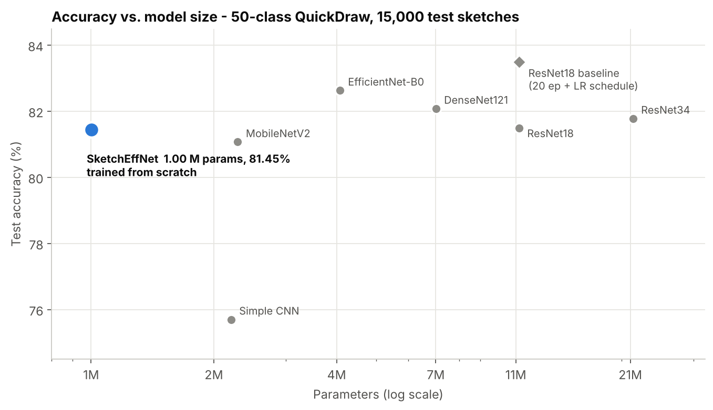
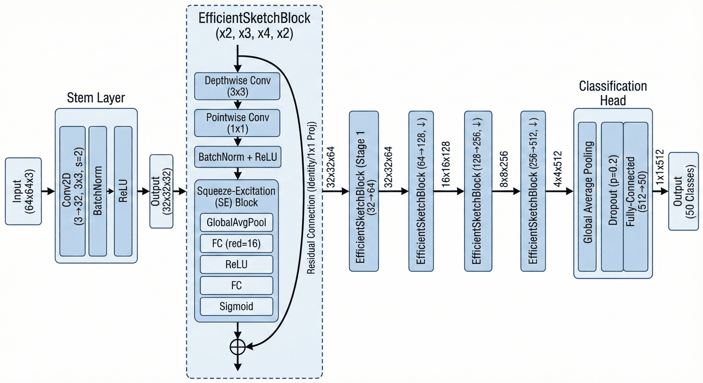
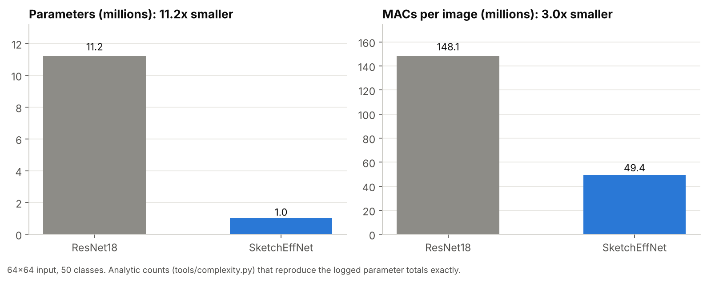
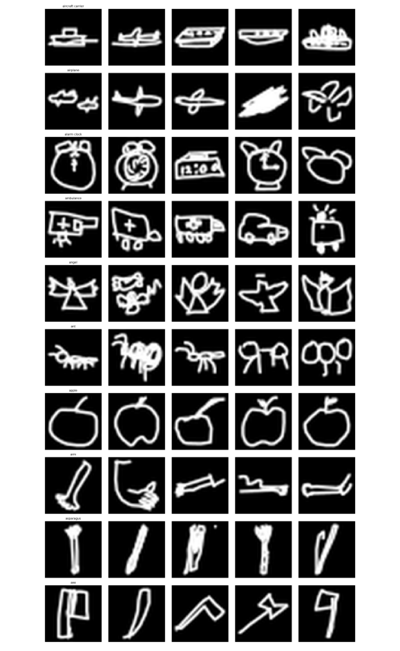
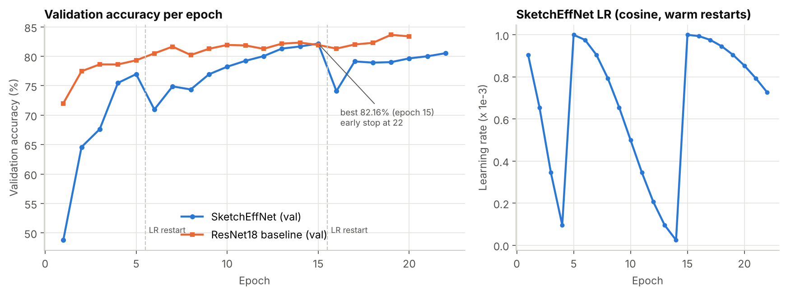
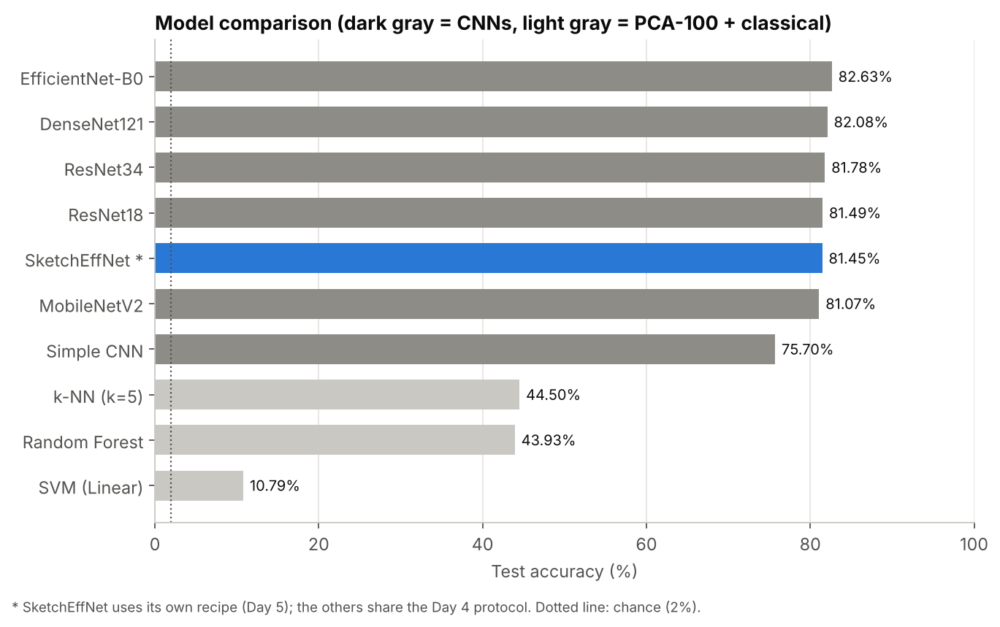
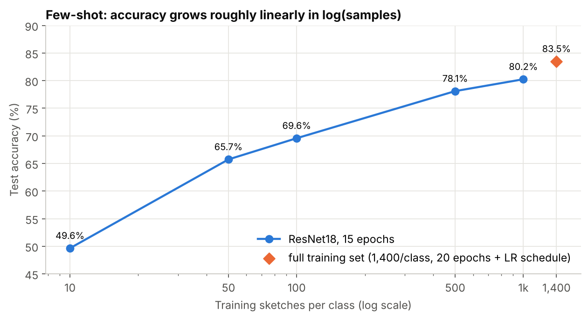
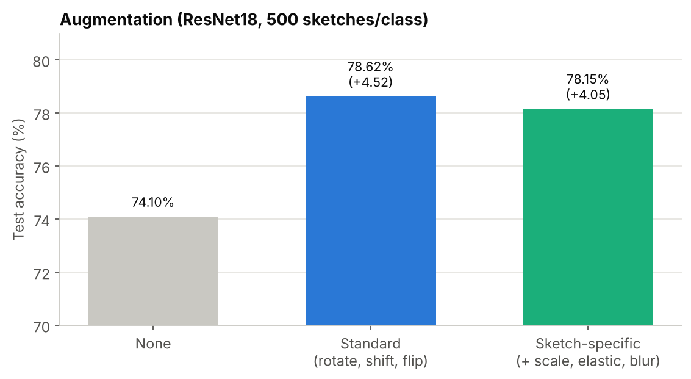
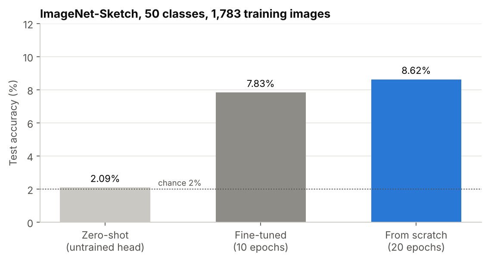
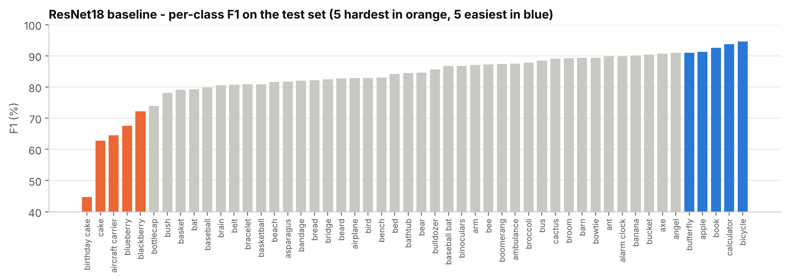

# SketchEffNet — Efficient Sketch Recognition on Google QuickDraw

[](https://github.com/tanvirul-islam-rifat/sketcheffnet-sketch-recognition/actions/workflows/ci.yml)


A **1.0-million-parameter CNN for hand-drawn sketch recognition**, designed for devices where memory matters. It combines **depthwise-separable convolutions**, **squeeze-and-excitation channel attention** and **residual shortcuts**. Trained from scratch on 100,000 Google QuickDraw sketches in 50 classes, it reaches **81.45 % test accuracy** with **11.2× fewer parameters** than an ImageNet-pretrained ResNet18 baseline (83.49 %). The project also compares 9 other models: CNNs, a hand-built CNN and three classical classifiers. Around that it runs controlled experiments on few-shot data, augmentation, transfer to unseen classes and transfer to another sketch dataset.

The results are **verified as code**. Every number comes from one recorded end-to-end run on a Kaggle Tesla T4, which is kept with all its output. A parser turns that log into versioned JSON, and a verifier checks it on every push: 40 checks covering split sizes, per-class metrics against the headline accuracy, logged learning rates against the scheduler formula, and parameter counts against an analytic model of the architecture. The verifier also checks every number in the accompanying paper. It confirmed the run is **bit-for-bit deterministic** and turned up **9 claims that need a correction or caveat** (see [Findings](#verifier-findings)).



## At a Glance

| | |
|---|---|
| **Task** | 50-class sketch classification: 64×64 rasterised QuickDraw doodles |
| **Data** | 2,000 sketches × 50 classes = 100,000 · stratified 70 / 15 / 15 split (seed 42) · 15,000-sketch balanced test set |
| **Model** | SketchEffNet: 11 depthwise-separable SE-residual blocks · **1,001,586 parameters · 3.82 MB fp32 · 49.4 M MACs** |
| **Result** | **81.45 %** test accuracy · 81.38 % weighted F1 · trained from scratch in 22 epochs (early stopping) |
| **Baseline** | ResNet18, ImageNet-pretrained: 83.49 % · 11,202,162 parameters · 148.1 M MACs |
| **Compared** | Simple CNN, MobileNetV2, ResNet18/34, DenseNet121, EfficientNet-B0, Random Forest, k-NN, linear SVM |
| **Experiments** | few-shot (10 → 1,000 per class) · 3 augmentation strategies · transfer to unseen classes · QuickDraw → ImageNet-Sketch |
| **Deliverables** | 6-page paper · reproducible pipeline (Day 1–6) · recorded run log · results verifier · 40 unit tests · CI · inference CLI |
| **Course** | CSE424 — Pattern Recognition, BRAC University |

## Architecture



Each **EfficientSketchBlock** applies a 3×3 depthwise convolution, a 1×1 pointwise convolution with BatchNorm and ReLU, and a squeeze-and-excitation gate (reduction 16), then adds a residual shortcut: identity, or a strided 1×1 projection when the shape changes.

| Stage | Blocks | Channels | Resolution | Parameters | MACs |
|---|---|---|---|---|---|
| Stem (3×3 conv, stride 2) | — | 3 → 32 | 32×32 | 928 | 0.88 M |
| Stage 1 | 2 | 32 → 64 | 32×32 | 10,464 | 9.27 M |
| Stage 2 | 3 | 64 → 128 | 16×16 | 59,200 | 13.33 M |
| Stage 3 | 4 | 128 → 256 | 8×8 | 305,536 | 17.33 M |
| Stage 4 | 2 | 256 → 512 | 4×4 | 599,808 | 8.56 M |
| Head (GAP · Dropout 0.2 · FC) | — | 512 → 50 | 1×1 | 25,650 | 0.03 M |
| **Total** | **11** | | | **1,001,586** | **49.4 M** |

The counts come from [`tools/complexity.py`](tools/complexity.py), an analytic model that reproduces all three parameter counts printed in the run log exactly: SketchEffNet, the 50-class ResNet18 and the 1,000-class ResNet18. The unit tests cross-check it against PyTorch's own parameter and FLOP counters.



**Design decision worth knowing:** SketchEffNet removes 91 % of ResNet18's parameters but only 67 % of its compute. ResNet18 shrinks a 64×64 input to 16×16 before its first residual stage (stride-2 stem plus max-pool). SketchEffNet keeps 32×32 through stage 1, which preserves thin strokes, and spends its compute there. Most of the parameters sit in the deep, low-resolution stages (stage 4 alone holds 60 %), so making those cheap pays off most in memory, not in speed.

## Dataset and Protocol



| Step | Detail |
|---|---|
| Source | [Google QuickDraw](https://github.com/googlecreativelab/quickdraw-dataset) 28×28 bitmaps (`.npy`); the first 50 categories alphabetically (*aircraft carrier* … *calculator*) |
| Sampling | 2,000 sketches per class, drawn with a fixed seed from each class's full file (e.g. 147,614 for *bandage*) |
| Preprocessing | 28×28 → 64×64 (Lanczos) → 3-channel → ImageNet mean/std normalisation |
| Split | stratified per class: 1,400 train / 300 val / 300 test (70,000 / 15,000 / 15,000) |
| Selection | best-validation checkpoint (Days 1, 5); test set touched once per model |
| Hardware | Kaggle Tesla T4; all seeds 42, `cudnn.deterministic = True` |

## Results

### SketchEffNet vs. the ResNet18 baseline

| Model | Params | fp32 size | MACs (64×64) | Test acc. | Weighted F1 | Train time (T4) |
|---|---|---|---|---|---|---|
| ResNet18 (ImageNet-pretrained, 20 epochs, plateau LR) | 11.20 M | 42.73 MB | 148.1 M | **83.49 %** | 83.33 % | 14.37 min |
| **SketchEffNet** (from scratch, AdamW, cosine restarts) | **1.00 M** | **3.82 MB** | **49.4 M** | 81.45 % | 81.38 % | 36.49 min |
| Difference | **−91.1 % (11.2×)** | **−38.91 MB** | **−66.6 % (3.0×)** | −2.04 pts | −1.95 pts | +2.5× |

Per million parameters, SketchEffNet delivers **10.9× more accuracy** (81.3 vs 7.45 points per M).



The validation accuracy drops at epochs 6 and 16 are the cosine schedule's **warm restarts**: the learning rate jumps back to 1e-3. The best epoch (15) is the last epoch before the second restart, and early stopping fired 7 epochs later. The verifier recomputes all 22 logged learning rates from the scheduler formula.

### Model comparison



| Model | Type | Params | Best val | **Test acc.** | Test F1 | Train time |
|---|---|---|---|---|---|---|
| EfficientNet-B0 | CNN, pretrained | 4.07 M | 82.77 % | **82.63 %** | 82.62 % | 12.29 min |
| DenseNet121 | CNN, pretrained | 7.01 M | 82.85 % | 82.08 % | 82.02 % | 20.17 min |
| ResNet34 | CNN, pretrained | 21.31 M | 82.22 % | 81.78 % | 81.69 % | 12.60 min |
| ResNet18 | CNN, pretrained | 11.20 M | 81.79 % | 81.49 % | 81.45 % | 10.47 min |
| *SketchEffNet* ¹ | *CNN, from scratch* | *1.00 M* | *82.16 %* | *81.45 %* | *81.38 %* | *36.49 min* |
| MobileNetV2 | CNN, pretrained | 2.29 M | 81.87 % | 81.07 % | 80.96 % | 10.49 min |
| Simple CNN | CNN, from scratch | 2.20 M | 76.53 % | 75.70 % | 75.41 % | 9.87 min |
| k-NN (k = 5) | PCA-100 pixels | — | 44.21 % | 44.50 % | 43.62 % | 0.21 min |
| Random Forest | PCA-100 pixels | — | 45.27 % | 43.93 % | 41.85 % | 1.36 min |
| Linear SVM ² | PCA-100 pixels | — | 10.91 % | 10.79 % | 9.52 % | 4.45 min |

Shared Day 4 protocol: 15 epochs, Adam (lr 1e-3), no scheduler, last-epoch weights. ¹ SketchEffNet was trained under its own Day 5 recipe; the row is for reference (Finding 4). ² Did not converge (Finding 7).

**Takeaways.** Every CNN beats every classical model by more than 30 points: on raw pixels, even 100 PCA components keep only 75 % of the variance. Among the five pretrained CNNs, the spread is just 1.6 points despite a 9× range in size. SketchEffNet lands in that cluster with no ImageNet pretraining at all.

### Few-shot learning



| Sketches / class | Training images | Test acc. | Test F1 | Share of full-data accuracy |
|---|---|---|---|---|
| 10 | 500 | 49.65 % | 48.92 % | 59.5 % |
| 50 | 2,500 | 65.73 % | 65.16 % | 78.7 % |
| 100 | 5,000 | 69.57 % | 69.69 % | 83.3 % |
| 500 | 25,000 | 78.10 % | 78.15 % | 93.5 % |
| 1,000 | 50,000 | 80.25 % | 80.28 % | 96.1 % |
| 1,400 (all) | 70,000 | 83.49 % | 83.33 % | 100 % |

ResNet18 throughout. Accuracy grows roughly linearly in log(samples). **500 sketches per class get within 5.4 points of the full training set.** In practice, after about 500 per class, collecting more categories is a better use of effort than more examples per category. (The full-data row is the Day 1 run, which trained longer and with a learning-rate schedule.)

### Augmentation



With 500 sketches per class, any augmentation adds more than 4 points. The sketch-specific variant (elastic deformation, scale, blur) did **not** beat plain rotation/shift/flip (78.15 % vs 78.62 %). The simpler policy is the better default here.

### Transfer to unseen classes

ResNet18 was trained on 40 classes and frozen. A k-NN (k = 5) on its 512-d features then classified the **10 classes it never saw**: banana, bed, bathtub, calculator, bear, arm, bucket, baseball bat, bird, bread. It scored **82.89 %** (chance 10 %), against 83.08 % validation accuracy on the 40 training classes. The features generalise to new sketch categories (t-SNE: [`docs/images/transfer_tsne_unseen.png`](docs/images/transfer_tsne_unseen.png)). The two numbers are not a "retention rate", though (Finding 5).

### Cross-dataset: QuickDraw → ImageNet-Sketch



On the first 50 ImageNet-Sketch classes (fish, birds, amphibians and reptiles; 2,548 detailed artistic drawings, none sharing a label with QuickDraw), every approach stays below 9 %. Fine-tuning the QuickDraw model (7.83 %) does no better than training from scratch (8.62 %). With about 36 training images per class, neither can learn the task, so the experiment cannot separate "QuickDraw features don't transfer" from "too little target data" (Findings 6 and Limitations). [`experiments/cross_dataset_tuberlin.py`](experiments/cross_dataset_tuberlin.py) sets up the cleaner test: TU-Berlin categories that *also exist* in QuickDraw, so the trained head can be used as is.

### Where the model fails



The errors are mostly semantic, not random. *Birthday cake* is the hardest class (F1 44.7 %; recall 32 %): most misses are predicted as *cake* (cake precision 51 %). *Blackberry* and *blueberry* are confused with each other, and *aircraft carrier* (recall 59 %) leaks into several classes. *Bicycle*, *calculator* and *book* score above 92 %. Confusion matrix: [`docs/images/confusion_matrix_resnet18.png`](docs/images/confusion_matrix_resnet18.png).

## Automated Results Verification

Training takes about 2.5 GPU-hours, so CI does not rerun it. Instead, every push checks that the recorded run is internally consistent and that every claim made about it holds:

```
$ python -m tools.verify_results            # excerpt
[PASS] results/ matches the recorded Kaggle run log
[PASS] Split is 70/15/15 of 100,000 sketches
[PASS] Test set is balanced: 50 classes x 300 sketches
[PASS] Per-class recalls average to the reported test accuracy (balanced set)
[PASS] Day 5 early stopping fired exactly 7 epochs after the best epoch
[PASS] Logged learning rates follow CosineAnnealingWarmRestarts(T_0=5, T_mult=2)
[PASS] Training is deterministic: the accidental second Day 5 run reproduced every epoch
[PASS] Architecture accounts for SketchEffNet's 1,001,586 parameters
[PASS] Architecture accounts for ResNet18's 11,202,162 parameters (50-class head)
[WARN] Paper: '91.4% parameter reduction'                 vs the 50-class ResNet18 actually trained it is 91.1% ...
[WARN] Paper abstract/contributions: 'sketch-specific augmentations provided a 4.52% improvement' ...
[PASS] Paper Tables IV-V: nine model-comparison accuracies
[WARN] Paper: zero-shot 2.09% shows 'QuickDraw features don't transfer' ...

31 passed, 9 finding(s), 0 failed          (excerpt - 40 checks in total)
```

How it works:

1. **Extract.** [`tools/extract_kaggle_results.py`](tools/extract_kaggle_results.py) parses the printed output of [`notebooks/kaggle_full_run.ipynb`](notebooks/kaggle_full_run.ipynb) (the actual run) into [`results/`](results/): configs, per-epoch histories, per-class reports and test metrics. No number is typed in by hand.
2. **Verify.** [`tools/verify_results.py`](tools/verify_results.py) runs the consistency checks above and recomputes each quantitative claim in the paper.
3. **Regenerate.** [`tools/make_figures.py`](tools/make_figures.py) draws every chart in this README from `results/`.
4. **Exercise the code.** CI also runs the 40 unit tests and the entire Day 1–6 pipeline end to end, in `--smoke` mode on synthetic data, plus the inference CLI and a CPU benchmark.

The tests also prove the verifier **catches mistakes**: an edited headline accuracy, an unbalanced test set, a wrong split, a tampered learning-rate log, an inconsistent early stop, a parameter count that doesn't match the architecture, a non-reproducible rerun and a paper table that disagrees with the log.

## Verifier Findings

1. **The parameter reduction was measured against the wrong ResNet18.** Day 5 compared against 11,689,512 parameters, which is ResNet18 with ImageNet's 1,000-class head. The baseline actually trained has a 50-class head: 11,202,162. The real reduction is **91.1 %** (not 91.4 %), memory saved is **38.91 MB** (not 40.77 MB), and the paper's Table I size for ResNet18 should read 42.73 MB (not 44.59 MB). Fixed in [`experiments/day5_sketcheffnet.py`](experiments/day5_sketcheffnet.py).
2. **The paper's abstract credits the wrong augmentation.** It says sketch-specific augmentation gave +4.52 %. In the run, +4.52 % is *standard* augmentation; sketch-specific gave +4.05 %. The paper's own Table III and conclusion state this correctly.
3. **The "full data" row of the few-shot table overstates its size.** It reads 2,000 sketches per class / 100,000 training images. The baseline trained on 1,400 per class (70,000 images); the other 600 per class are validation and test. It also trained under a different protocol (20 epochs with an LR schedule vs 15 without).
4. **"SketchEffNet nearly matches ResNet18 (81.45 % vs 81.49 %)" compares two different recipes.** That ResNet18 number is Day 4 (pretrained, 15 epochs, last epoch). SketchEffNet's is Day 5 (from scratch, AdamW + cosine restarts, best checkpoint). Both are within one 95 % confidence interval (±0.6 pts) anyway. `python -m experiments.day4_model_comparison --with-sketcheffnet` now trains it under the identical protocol.
5. **"99.8 % performance retention" on unseen classes divides unlike quantities:** a 10-way k-NN accuracy (chance 10 %) over a 40-way softmax accuracy (chance 2.5 %). Both numbers are valid; their ratio is not a retention measure.
6. **The zero-shot ImageNet-Sketch result is chance by construction.** The QuickDraw head is discarded and a freshly initialised 50-way head is evaluated without training, on classes QuickDraw never contained. 2.09 % vs 2.00 % chance says nothing about the features.
7. **The linear SVM did not converge.** `SVC(kernel="linear", max_iter=1000)` on 70,000 samples hits the iteration cap. Warnings were suppressed in the run, so no ConvergenceWarning was logged. Its 10.79 % is a solver artefact, not a measure of linear separability. k-NN reaches 44.50 % on the same features.
8. **11× fewer parameters ≠ 11× less compute.** SketchEffNet needs 3.0× fewer MACs, not 11× (see Architecture). Training also took 2.5× longer than ResNet18 on the T4 (36.49 vs 14.37 min). The likely causes are its higher-resolution early stages, depthwise convolutions (memory-bound on GPUs) and CPU-side elastic augmentation. Inference latency was never measured; [`tools/benchmark_inference.py`](tools/benchmark_inference.py) now measures it.
9. **The Day 6 script re-ran all of Day 5 by accident:** `from day5_custom_efficient_model import SketchNet` executed the whole training script on import (37 minutes). It had one useful side effect: the second run reproduced all 22 epochs and the 81.45 % test accuracy **exactly**, which proves the pipeline is deterministic. The model now lives in a side-effect-free module.

The paper PDF is kept unchanged as submitted; this README and `results/` carry the corrected figures.

## Run It

**Check the recorded results** (Python 3.10+, no GPU, no dataset, no PyTorch):

```bash
git clone https://github.com/tanvirul-islam-rifat/sketcheffnet-sketch-recognition.git
cd sketcheffnet-sketch-recognition
pip install numpy pandas pillow matplotlib scikit-learn tabulate

python -m tools.verify_results -v        # 40 checks against the recorded run
python -m tools.complexity               # per-stage parameters and MACs
python -m unittest discover -s tests -t . -v
```

**Run the full pipeline.** On Kaggle, open [`notebooks/run_pipeline.ipynb`](notebooks/run_pipeline.ipynb), attach the QuickDraw and ImageNet-Sketch datasets, choose a T4 GPU and run all cells (about 2.5 h; paths are detected automatically). Locally (CUDA, Apple Silicon or CPU):

```bash
python -m venv .venv && source .venv/bin/activate
pip install -r requirements.txt                       # needs a Kaggle API token for the download
python scripts/download_quickdraw.py && python scripts/check_dataset.py

python -m experiments.day1_baseline                   # data prep + ResNet18 baseline
python -m experiments.day2_experiments                # few-shot / augmentation / transfer
python -m experiments.day3_analysis                   # tables
python -m experiments.day4_model_comparison           # 6 CNNs + 3 classical (add --with-sketcheffnet)
python -m experiments.day5_sketcheffnet               # SketchEffNet
python -m experiments.day6_cross_dataset_imagenet_sketch
```

Every stage accepts `--smoke` for a run of a few seconds to minutes, with tiny settings. `python scripts/make_synthetic_data.py` creates stand-in data, so the whole chain runs without Kaggle (this is what CI does).

**Classify your own drawing** (with `models/sketchnet_best.pth`, see [`models/`](models/README.md)):

```bash
python -m sketcheffnet.predict my_drawing.png     # prints the top-5 classes with probabilities
```

Any drawing works: dark-on-light images are inverted, cropped to the strokes and resampled to look like a QuickDraw bitmap.

**Measure inference speed:** `python -m tools.benchmark_inference [--device cuda|mps]`

## Repository Structure

```
├── README.md
├── sketcheffnet/                    # the library (no side effects on import)
│   ├── model.py                     # SketchEffNet (SketchNet) + SE / depthwise-separable blocks
│   ├── baselines.py                 # torchvision baselines + Simple CNN
│   ├── data.py                      # .npy sampling, rendering, stratified split, transforms
│   ├── training.py                  # one fit/evaluate loop for every experiment
│   ├── config.py                    # paths (local / Kaggle / env), categories, device selection
│   ├── plotting.py
│   └── predict.py                   # inference CLI
├── experiments/                     # Day 1-6 pipeline + TU-Berlin extension, each with --smoke
├── scripts/                         # dataset download / check, synthetic data generator
├── tools/
│   ├── extract_kaggle_results.py    # run log -> results/*.json
│   ├── verify_results.py            # 40 consistency checks + paper-claim checks
│   ├── complexity.py                # analytic parameters & MACs per stage
│   ├── make_figures.py              # README figures from results/
│   └── benchmark_inference.py       # latency / throughput on the local machine
├── results/                         # recorded results (JSON/CSV) + cleaned per-stage logs
├── notebooks/
│   ├── kaggle_full_run.ipynb        # THE recorded run, with all output
│   ├── run_pipeline.ipynb           # run everything on Kaggle or locally
│   └── archive/tf_keras_baseline.ipynb   # early TensorFlow exploration (superseded)
├── tests/                           # 40 unit tests (results, data, model, training)
├── docs/
│   ├── SketchEffNet_Paper.pdf       # 6-page paper
│   ├── EXPERIMENT_LOG.md            # day-by-day history and what changed in the refactor
│   └── images/
├── archive/original_scripts/        # the unmodified scripts that produced the results
├── models/                          # put trained checkpoints here (not committed)
└── .github/workflows/ci.yml
```

## Limitations

- **One run per configuration, no repeated seeds.** With 15,000 test sketches, each accuracy carries a 95 % confidence interval of about ±0.6 points. Gaps smaller than about 1 point (for example, among the top five CNNs) are not significant. The ImageNet-Sketch test set has 383 images (±2.8 points).
- **The baseline and SketchEffNet use different recipes.** Pretraining, optimiser, schedule and epochs all differ, so the 2.04-point gap mixes architecture with training. The `--with-sketcheffnet` Day 4 run gives a like-for-like comparison; it has not been run yet.
- **50 of 345 QuickDraw categories,** the first 50 alphabetically rather than a random sample, so some hard pairs (cake/birthday cake, blueberry/blackberry) are over-represented.
- **Raster only.** Images are 28×28 bitmaps upsampled to 64×64. Stroke order and timing, which QuickDraw also provides, are not used.
- **No measured latency, energy or quantised accuracy in the recorded run.** The benchmark tool measures latency on whatever machine runs it.
- **The cross-dataset test is confounded** (no shared labels, about 36 training images per class). The same-label TU-Berlin experiment is implemented, but its full run has not been done yet.
- **Trained weights are not in the repository** (git-ignored; see `models/`).
- The archived TensorFlow/Keras exploration (`notebooks/archive/`) used a different split and is not comparable. Several of its models collapsed during training; they are kept as a record of the path that led to the PyTorch pipeline.

## Technical Architecture
- **Language & Framework:** Python 3, PyTorch 2 / torchvision (models, transforms, `FlopCounterMode`), scikit-learn (PCA, Random Forest, k-NN, SVM, t-SNE, metrics)
- **Model:** custom depthwise-separable CNN with squeeze-and-excitation attention and residual shortcuts (1.0 M parameters), against 6 torchvision/hand-built CNN baselines and 3 classical classifiers
- **Training:** AdamW + cosine annealing with warm restarts, early stopping, best-checkpoint selection, seeded and deterministic cuDNN; runs on CUDA, Apple Silicon (MPS) or CPU
- **Data:** Google QuickDraw `.npy` bitmaps → PNG + CSV split manifests; ImageNet-Sketch and TU-Berlin for cross-dataset tests; Kaggle API / `kagglehub` for acquisition
- **Verification tooling:** log parser, results verifier, analytic complexity model, `unittest`, GitHub Actions; matplotlib for figures
- **Interface:** command-line experiment stages (`python -m experiments.*`), an inference CLI, and a Kaggle/Jupyter notebook

## Core Engineering Practices Demonstrated
- **Efficient Model Design:** Depthwise-separable convolutions, SE attention and residuals combined into an 11-block network. It cuts parameters by 91 % with a 2-point accuracy cost, and the compute trade-off is analysed per stage instead of assumed.
- **Controlled Experimentation:** One fixed stratified split and seed for every experiment. Few-shot, augmentation, transfer and cross-dataset studies each change a single variable.
- **Baselines That Mean Something:** Six CNNs and three classical models evaluated on the same 15,000 test sketches, with the protocol differences stated rather than hidden.
- **Results as Data, Not Screenshots:** The recorded run is parsed into versioned JSON. Every table and figure is generated from it, so documentation cannot drift from the evidence.
- **Evidence-Based Verification:** 40 automated checks found a wrong reference model in the headline parameter reduction and a mis-attributed augmentation gain. They also flagged a zero-shot result that was chance by construction and an unconverged SVM, and they proved the training run is deterministic.
- **Testing Discipline:** Unit tests include deliberately corrupted results that the verifier must reject. PyTorch's FLOP counter is cross-checked against the analytic model, and CI runs the full pipeline end to end on synthetic data.
- **Refactoring Without Changing Results:** Kaggle notebooks were turned into a side-effect-free package with a shared training loop. Every recorded hyperparameter, transform, split and seed is preserved, and the originals are archived for diffing.
- **Honest Engineering:** Findings, confounds, statistical precision and experiments not yet run are documented as such.

## Author
**Md. Tanvirul Islam Rifat** — designed the model, ran the experiments, wrote the paper and built this repository. CSE424 (Pattern Recognition), BRAC University.
- **GitHub:** [@tanvirul-islam-rifat](https://github.com/tanvirul-islam-rifat)
- **LinkedIn:** [Tanvirul Islam Rifat](https://www.linkedin.com/in/tanvirul-islam-rifat)
